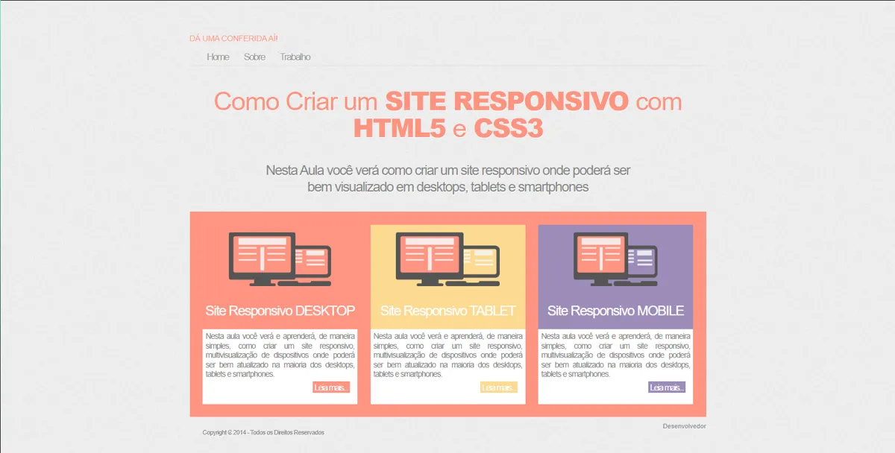

# Site Responsivo — Estudo de layout

Página de estudo que compara **layout fixo, layout líquido e layout responsivo** e mostra como o mesmo conteúdo se adapta a computador, tablet e celular.

🔗 **[Ver o site no ar](https://iamviniciuslima05.github.io/PROJETO-responsividade/responsive/responsive.html)**



## O que tem no projeto

- Explicação dos três tipos de layout
- Exemplos de como a página fica no **desktop**, no **tablet** e no **celular**
- Uso de **media queries** para mudar o layout conforme a largura da tela

## Tecnologias

HTML5 · CSS3 · Media queries

## Estrutura

```
responsive/ → página (responsive.html)
css/        → estilos (responsive.css)
img/        → imagens
```

## Como rodar

Abra `responsive/responsive.html` no navegador e mude a largura da janela para ver o layout se adaptando.

---
Feito por **Vinicius Lima** · [Portfólio](https://viniciuslimadev.netlify.app) · [LinkedIn](https://www.linkedin.com/in/viniciuslima25/)
